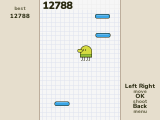

# Doodle Jump

Bounce from platform to platform, as high as you can. Lima Sky's game for the NumWorks calculator, on its own graph paper.

- **He jumps by himself.** The arrows (or 4 and 6) steer him, and going off one side of the page brings him back on the other.
- **Every platform.** Green ones stay, blue ones slide, brown ones break under him, white ones are gone after one jump and yellow ones turn orange, then red, then blow up.
- **Springs, trampolines, propeller hats and jetpacks** throw him higher.
- **Monsters and black holes.** Shoot a monster with OK or land on its head. Touch it any other way and he falls. A black hole takes him.
- **Harder as you climb.** The platforms spread out and more of them slide, vanish or explode.
- **The original's page.** Its 320 by 480 page at half size, so every jump and gap is the one you know.
- Your climb and high score are saved, so you can stop and carry on later.

## Controls

| Key | Action |
| --- | --- |
| Left and Right, or 4 and 6 | Steer |
| OK, EXE or Up | Shoot |
| Back | Menu: resume, new game, how to play, quit |

## Credits

Doodle Jump is **[Lima Sky](https://limasky.com)**'s game (2009). **[Bobydeluxe](https://github.com/Bobydeluxe)** brought it to NumPlay. This version is written in C for NumPlay with no code or art from the original, drawn in its style. Its French texts are the original's own where it has them.

Inside NumPlay it draws with the launcher's own shapes and fonts and saves through its file functions, so the game itself is about 8 KB.

It comes inside [NumPlay](https://github.com/Mason363/NumPlay), or on its own as `DoodleJump.nwa` from the [latest release](https://github.com/Mason363/NumPlay/releases/latest).

Build: `make` (needs `arm-none-eabi-gcc` and Node.js for nwlink). Tests: `make test`.
