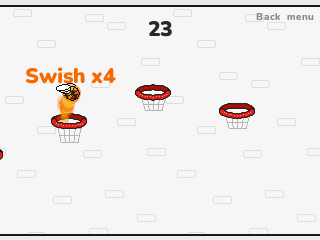

# Flappy Dunk

Flap the winged ball and drop it down through every hoop. Voodoo's endless game for the NumWorks calculator, playing and looking like the phone game.

- **One button.** Each press of OK flaps the wings once, and the ball falls in between.
- **Every hoop, from above.** Miss one and the run is over. The floor and the ceiling bounce the ball back, and the rims stop it dead, like in the original.
- **Swishes.** Go through without touching the rim for a swish. A basket is worth 1, a swish 2, and every swish in a row one more: 3, 4, 5... From the second one the ball catches fire.
- **The real numbers.** Gravity, flap, speed, the size of the ball and hoops, and how the rims and floor behave come from the game's own files.
- **Harder as you go.** Tilted hoops after 10 baskets, hoops moving up and down or side to side after 20, narrower ones after 40.
- **Six balls**, unlocked with the original's goals: score 20, 50 or 125, 10 swishes in a row, 100 swishes in all.
- Your run, best score and balls are saved, so you can stop and carry on later.

## Controls

| Key | Action |
| --- | --- |
| OK, EXE or Up | Flap |
| Back | Menu: Resume, Balls, How to play, Quit |

## Credits

Flappy Dunk is **Voodoo**'s game (2017), developed with Acid Cousins. **[Bobydeluxe](https://github.com/Bobydeluxe)** brought it to NumPlay. This version is written in C for NumPlay with no code or art from the original. Its physics and hoops follow the numbers in the game's Android build, and its French and Chinese texts are the original's own where it has them.

Inside NumPlay it draws with the launcher's own shapes and fonts and saves through its file functions, so the game itself is about 8 KB.

It comes inside [NumPlay](https://github.com/Mason363/NumPlay), or on its own as `FlappyDunk.nwa` from the [latest release](https://github.com/Mason363/NumPlay/releases/latest).

Build: `make` (needs `arm-none-eabi-gcc` and Node.js for nwlink). Tests: `make test`.
