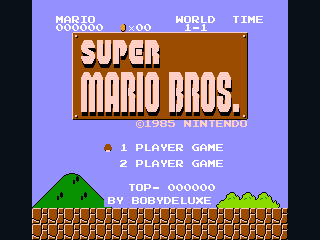
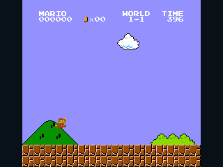

# Super Mario Bros.

NumWorks adaptation by **Bobydeluxe**, using the complete original NES campaign
and the [SMB-Vanilla](vendor/UPSTREAM.md) native C engine. Original game, levels,
characters and artwork by **Nintendo**. Not affiliated with Nintendo.




## Play

Install standalone **SuperMarioBros.nwa** with a compatible NumWorks external-app
installer, then open it from the calculator's Home menu. It belongs to NumPlay's
**big games, installed on their own** category. It is built and downloaded
separately, and is not included in the combined NumPlay launcher.

Press **EXE** on the original title screen to start. **Alpha** switches between
one and two players. Mario and Luigi take turns on the same calculator, as in
the original game. After loading a saved adventure, **OK** resumes from pause.

| Key | Action |
| --- | --- |
| Left / Right, or 4 / 6 | Walk |
| Hold Shift, or 0 | Run; throw fireballs when powered up |
| OK, or 5 | Jump; swim upward underwater |
| Up, or 8 | Climb a vine |
| Down, or 2 | Duck; enter a downward pipe |
| EXE | Original Start button: start or toggle NES pause |
| Alpha | Original Select button on the title screen |
| Back | Open the adaptation's pause menu |
| Toolbox | Open the controls screen |
| Home / On-Off | Save and exit safely |

Hold a direction into an enterable side pipe. Jump height responds to how long
the jump button is held. Stomp enemies, kick shells, collect coins and items,
break bricks when big, and reach the flagpole or castle axe. One hundred coins
grant a life. Fire Flowers, Super Mushrooms, Stars and 1-Up Mushrooms keep their
original behavior. There is no added shop, challenge or monetization system.

## Complete campaign

All **32 stages, World 1-1 through World 8-4**, retain the original level/enemy
tables, automatic entrance areas, pipe sub-areas, coin rooms, vines, Warp Zones,
moving lifts, springboards, underwater sections and castle loops. The original
enemy roster, Bowser encounters, life/game-over logic, halfway checkpoints,
level transitions, ending messages and second quest are present in the engine.

This is native gameplay code rather than a generic NES emulator. The original
256x240 scene is drawn pixel for pixel, centred on the 320x240 display, with
the original sprites, backgrounds, animation, font and HUD. The English pause
menu adds Resume, New Game, Controls and Save and Exit. Restarting asks before
discarding the current adventure. The adaptation's title credit is
**by Bobydeluxe**; Nintendo's original title credit remains.

The NumWorks version has no audio output. Sound-engine timers remain active to
preserve gameplay timing, but it does not play music or sound effects.
The core's [known differences from NES hardware](vendor/UPSTREAM.md) apply;
cycle-accurate lag frames and arbitrary invalid worlds are not reproduced.

## Save and resume

`supermario.sav` holds a checked **4,404-byte** exact snapshot: original game
RAM, both tile/attribute tables, palette, displayed OAM state, scroll and frame
state. Native pointers and firmware addresses are rebuilt after loading, so
saves can move between supported models. A loaded game opens frozen in pause.

Progress is saved on pause, every ten seconds and on exit. If storage is full,
an interactive screen offers retry, return to the game or an explicit exit
without saving. Invalid saves are rejected before live state is changed;
unrelated calculator records are preserved. An internal invariant failure
returns to an error screen instead of exiting through an OS abort routine;
it cannot overwrite the last good save.

## Build

Requires ARM GCC with newlib, Python 3 and nwlink 1.0.0. The portable builder
also uses pyelftools. Pillow is needed only for asset regeneration and ARM
screenshots; py65 1.2.0 is optional for reconstructing the reference data.

```sh
make build module check
make test
make replay
make fidelity
python tests/arm.py --nwlink nwlink

# Portable build, including Windows without Make:
python tools/build.py --toolchain /path/to/arm/bin --nwlink /path/to/nwlink/bin/nwlink

# Offline generated-data/icon verification:
python tools/assets.py --check
```

Keep `-fwrapv -fsigned-char -fno-strict-aliasing`: ARM's default unsigned char
would change the original loop-command parser. Engine source, its GPL licence
and local changes are documented in [vendor/UPSTREAM.md](vendor/UPSTREAM.md).
[Asset provenance](assets/README.md) records the supplied wiki references,
disassembly, graphic patterns, original rights and hashes.

## Optimized complete build

The complete campaign, graphics, rules and simulation rate remain unchanged.
Writable memory now contains just the original 2 KiB CPU RAM, the two
name/attribute tables and palette. Read-only tables stay in flash, with no
duplicate RAM copy. A checked sparse address map removes unused 6502 code from
the embedded data; all original data directives and dynamic read windows remain.
Private names in the release ELF are shortened without changing installed code.
Graphics still use a 5,120-byte strip, without a full-screen framebuffer or heap.
There is no runtime asset decompression.

| Resource | Before (bytes) | Optimized (bytes) | Reduction |
| --- | ---: | ---: | ---: |
| Downloadable NWA | 130,376 | 101,868 | 21.9% |
| Installed code/assets | 97,465 | 75,881 | 22.1% |
| Static RAM | 91,934 | 14,142 | 84.6% |
| Save payload | 4,404 | 4,404 | unchanged |

The pre-optimization save format is preserved exactly. A differential regression
test matches **42,656 serialized simulation states and 331 RGB565 images** to
the unoptimized build, including all 32 level starts, power-ups, ending/menu
scenarios and the reference recording. `make fidelity` checks the frozen
pre-optimization fingerprint; the separate ROM test compares all retained bytes
against the full original tables and imports an old save.

Simulation advances at 60 Hz, drawing at up to 30 Hz. Release/debug installed
bytes match on N0110, N0115/custom RAM, N0120 and Upsilon. All 32 level scenarios
run in the ARM emulator; pause, exact restoration, two-player selection, full
storage, safe exits and final-world state transitions are checked. The render
maximum observed in these scenarios is 13 ms, below the 33 ms drawing interval.
These are emulator results; physical calculator timing remains to be checked.

See [validation details](VALIDATION.md) and the
[32-stage screenshot gallery](docs/all-worlds.png).
