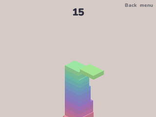

# Tower Blocks

Drop each moving block on the tower; what hangs over the edge falls off. Steve Gardner's Tower Blocks for the NumWorks calculator, ported from its source.

- **One button.** Each block slides in from one side, along one edge of the tower and then the other. Press OK to drop it.
- **Cut to size.** The part over the block below stays and the rest falls away, so the blocks get smaller. Land within a hair of it and the block stays whole.
- **Faster and faster.** Every block comes a little quicker than the one before, as in the original.
- **The original's look.** Its pastel colours shifting up the tower, its light and its camera, with the cut pieces tumbling away. When the game ends the tower shrinks away from the top and the score counts down.
- Your tower and best score are saved, so you can stop and carry on later.

## Controls

| Key | Action |
| --- | --- |
| OK or EXE | Drop the block |
| Back | Menu: Resume, New game, How to play, Quit |

## Credits

Tower Blocks is **[Steve Gardner](https://codepen.io/ste-vg)**'s game ([on CodePen](https://codepen.io/ste-vg/pen/ppLQNW), MIT License), the one Y8 shows as Tower Block. **[Bobydeluxe](https://github.com/Bobydeluxe)** brought it to NumPlay. This version is written in C from its source: its sizes, speeds, colours, light and camera are the original's (see [LICENSES/MIT-TowerBlocks.txt](../../LICENSES/MIT-TowerBlocks.txt)).

Inside NumPlay it draws with the launcher's own shapes and fonts and saves through its file functions, so the game itself is about 5 KB.

It comes inside [NumPlay](https://github.com/Mason363/NumPlay), or on its own as `TowerBlocks.nwa` from the [latest release](https://github.com/Mason363/NumPlay/releases/latest).

Build: `make` (needs `arm-none-eabi-gcc` and Node.js for nwlink). Tests: `make test`.
